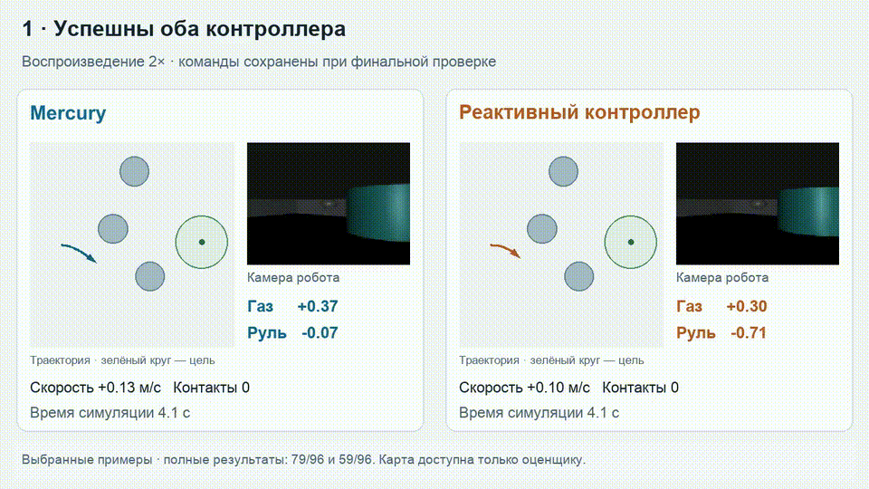
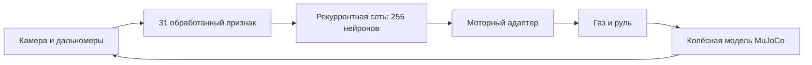

# Mercury

**Коннектомный контроллер локальной навигации мобильного робота**

Mercury получает изображение камеры и показания датчиков, обрабатывает их в 31 числовой признак и формирует газ и руль. Рекуррентная сеть использует компактный подграф коннектома дрозофилы FlyWire: **255 нейронов и 4 088 направленных связей**. Веса разрешённых связей и моторного адаптера настраиваются при обучении.

Проект решает задачу движения к обозначенной цели среди неподвижных препятствий с устойчивой остановкой. Предлагаемое применение — локальные переезды между рабочими точками склада или мастерской. Реализованы программный прототип, испытания в кинематической симуляции MuJoCo и локальная галерея поездок.



[Запуск](#быстрый-старт) · [Результаты](#результаты) · [Проверка отчётов](#проверка-сохранённых-результатов) · [Устройство проекта](PROJECT_MAP.md) · [Источники и права](THIRD_PARTY.md)

## Результаты

В парной проверке от 14 октября 2026 года оба контроллера получили одинаковые **96 новых сцен**, одинаковые сенсорные признаки и критерий успеха.

| Показатель | Mercury | Настроенный реактивный контроллер |
|---|---:|---:|
| Успешные поездки | **79 / 96 (82,3%)** | 59 / 96 (61,5%) |
| Успешные поездки на 48 сложных сценах | **38 / 48 (79,2%)** | 21 / 48 (43,8%) |
| Поездки хотя бы с одним контактом | **6 / 96** | 14 / 96 |

Разница долей успешных поездок — **20,8 процентного пункта**, или **20 дополнительных успешных поездок** на общем наборе сцен.

Успех требует расстояния до цели не более 0,5 м, абсолютной скорости не более 0,03 м/с в течение 0,5 с и отсутствия контактов за всю поездку. Лимит — 48 секунд симуляции. Учитель в проверочных поездках не используется; параметры модели фиксированы.

[Протокол и полный набор результатов](results/2026-10-14-classical-comparison/README.md). Прежние испытания 23/32 и сравнение обученных версий сохранены в [истории исследований](docs/README.md); это отдельные наборы сцен.

## Быстрый старт

Проверенное окружение: Python 3.11, macOS. Для установки нужен Python с доступными пакетами PyTorch и MuJoCo.

```bash
git clone https://github.com/NilLev06/DigitalFlyCar.git Mercury
cd Mercury
python3 -m venv .venv
source .venv/bin/activate
python -m pip install --upgrade pip
python -m pip install -r requirements.txt
python scripts/run_map_gallery.py
```

В Windows активация окружения: `.venv\Scripts\activate`. Сервер открывает локальную страницу `http://127.0.0.1:8766/maps`. Для остановки нажмите `Ctrl+C` в терминале.

Сохранённая модель включена в репозиторий. Для просмотра поездок исходный архив полного коннектома скачивать не нужно.

### Запуск на macOS двойным кликом

После установки зависимостей откройте **[Mercury Gallery.command](Mercury%20Gallery.command)**. Запуск использует `.venv/bin/python` из папки проекта. Для другого окружения задайте путь к Python в `MERCURY_PYTHON`. Прежняя переменная `DIGITAL_FLY_PYTHON` также поддерживается.

[Mercury.command](Mercury.command) открывает лабораторию обучения и проверок. Старые файлы запуска оставлены для совместимости.

## Что показывает галерея

Каталог содержит 231 карту из прежних проверок: выбор сцены, траекторию, камеру, шесть дальномеров, скорость, контакты, команды газа и руля и активность рекуррентной сети. Просмотр запускает новый проезд сохранённой модели. Исторический результат и результат текущего сеанса показываются отдельно.

Набор из 96 сцен сравнительной проверки опубликован отдельно в `results/`: число карт галереи и размер этой проверки обозначают разные наборы.

Веса не изменяются при просмотре. Перед каждой поездкой внутреннее состояние сбрасывается. SHA-256 модели проверяется перед запуском и после поездки:

```text
e7155c9a2104a61f2936989a7d0b5b8bd2902e2e09ed2f1925c7c018958b5702
```

## Как устроено управление



Коннектом задаёт разрешённые связи сети. Обучение использует демонстрации и корректирующие примеры по подходу DAgger. В симуляции цветовые детекторы выделяют цель и препятствия. При самостоятельной поездке сеть получает сенсорные признаки; карта и координаты мира используются для отображения и оценки результата.

Ближайший научный аналог — [FLYNN](https://arxiv.org/abs/2607.00025). Сопоставление размеров рекуррентных сетей:

| Показатель | FLYNN | Mercury |
|---|---:|---:|
| Нейроны (узлы сети) | 139 255 | 255 |
| Направленные связи | 5 342 445 | 4 088 |

Mercury содержит примерно в 546 раз меньше нейронов и в 1 307 раз меньше связей. Прикладное развитие предусматривает перенос на физическую платформу и проверку микроконтроллерного исполнения на ESP32-S3.

## Проверка сохранённых результатов

Для пересчёта основных показателей достаточно стандартной библиотеки Python:

```bash
python3 scripts/verify_saved_results.py
```

Скрипт проверяет 192 отчёта, парность 96 сцен, критерий остановки, доли успеха и контрольные суммы. Он читает данные, не запускает симуляцию, не обучает сеть и не переписывает отчёты.

## Разработка

```bash
python -m unittest discover -s tests
node --check fly_brain_rc/dashboard/static/gallery.js
```

В тестах проверяются сенсорные интерфейсы, обучение, сохранение модели, галерея и локальный сервер. Нужные для тестов зависимости входят в `requirements.txt`; для проверки JavaScript нужен Node.js.

| Каталог | Содержимое |
|---|---|
| `fly_brain_rc/imitation/` | Сеть, обработка признаков, учитель, обучение и проезд |
| `fly_brain_rc/sim/` | Колёсная модель, сцены и сенсоры MuJoCo |
| `fly_brain_rc/dashboard/` | Локальная галерея и лаборатория |
| `artifacts/imitation/versions/` | Сохранённые модели |
| `results/2026-10-14-classical-comparison/` | Актуальное парное сравнение |
| `scripts/`, `tests/` | Сценарии запуска и автоматические проверки |
| `docs/` | Протоколы и история исследований |

Автор проекта — **Нильмаер Лев Владимирович**. Источники анатомических данных и условия их распространения перечислены в [THIRD_PARTY.md](THIRD_PARTY.md).
