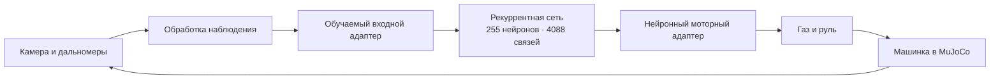

<div align="center">

# Digital Fly Car

### Нейронная навигация на основе подграфа коннектома мухи

**255 нейронов · 4 088 связей · 231 карта для живого просмотра**

[Начать](#быстрый-старт) · [Как работает](#как-это-работает) · [Результаты](#измеренные-результаты) · [Карта проекта](PROJECT_MAP.md)

</div>

---

Digital Fly Car — исследовательский проект: машинка в MuJoCo получает изображение и показания датчиков, а рекуррентная нейросеть выбирает газ и руль. Структура её внутренних связей взята из небольшого анатомического подграфа FlyWire.

Цель проекта — показать возможность такого управления и сделать его поведение наблюдаемым: выбрать карту, увидеть настоящий проезд, посмотреть камеру, траекторию и внутреннее состояние сети.

> **Статус:** работающая симуляция и локальная веб-галерея. Полный мозг мухи, универсальная навигация и перенос на физическую машинку пока не реализованы.

## Живая галерея

В браузере доступны **231 воспроизводимая карта**: 7 базовых, 32 из прежней сложной проверки и 192 из последующего независимого сравнения.

- Миниатюры карт, поиск и фильтры по результатам.
- Настоящая симуляция MuJoCo с видом сверху и траекторией.
- Изображение бортовой камеры и шесть дальномеров.
- Скорость, газ, руль, контакты и расстояние до цели.
- Тепловая карта 255 непрерывных состояний рекуррентной сети.
- Запуск, остановка, повтор и скорость просмотра от 0,5× до 4×.

Неудачные карты тоже доступны. Исторические оценки и результаты нового проезда отображаются отдельно. Просмотр **не обучает модель**: веса фиксированы, внутреннее состояние сети сбрасывается перед каждым проездом.

## Быстрый старт

### В готовом окружении проекта на macOS

Откройте **[`Fly Map Gallery.command`](Fly%20Map%20Gallery.command)** двойным кликом, затем выберите карту и нажмите **«Запустить карту»**.

Пульт работает локально на вашем компьютере; браузер открывается автоматически. Это не размещённая в интернете демонстрация. Терминал сервера должен оставаться открытым; для завершения — `Ctrl+C`.

Файлы `.command` рассчитаны на подготовленное окружение разработки. Свой интерпретатор можно указать через `DIGITAL_FLY_PYTHON`. Для первого запуска после клонирования используйте инструкции ниже.

### Из командной строки

Нужен Python с PyTorch, MuJoCo, NumPy, OpenCV и дополнительными зависимостями из `requirements-imitation.txt`. Разработка и проверки выполнялись на Python 3.11 в macOS.

```bash
git clone https://github.com/NilLev06/DigitalFlyCar.git
cd DigitalFlyCar

python -m venv .venv
source .venv/bin/activate
python -m pip install numpy opencv-python mujoco
python -m pip install -r requirements-imitation.txt

python scripts/run_map_gallery.py
```

На macOS сервер автоматически использует соседний `mjpython` для процесса MuJoCo. Сохранённые веса включены в репозиторий; для просмотра фаворита скачивать исходный архив коннектома не требуется.

Другие точки входа:

| Запуск | Назначение |
|---|---|
| `Digital Fly Car.command` / `python run.py lab` | Лаборатория с режимами обучения и проверки |
| `Try Complex Fly.command` | Прежний просмотр 32 сложных карт в отдельном окне MuJoCo |
| `python scripts/run_map_gallery.py --port 8770` | Галерея на другом локальном порту |

## Как это работает



**Коннектом задаёт топологию.** Модель использует анатомическую маску соединений из FlyWire v783. При обучении параметры разрешённых связей и адаптеров могут изменяться; новые связи вне маски не добавляются.

**Восприятие предварительно обрабатывается.** В симуляции цветовые детекторы выделяют цель и препятствия. Дальномеры и признаки изображения преобразуются во вход сети. YOLO в текущем тракте нет.

**Команды выбирает нейросеть.** Галерея запускает самостоятельный проезд без учителя. Координаты мира используются для изображения карты и оценки результата, а не передаются политике как готовый маршрут.

Это модель с непрерывными рекуррентными состояниями, не спайковая биофизическая реконструкция полного мозга. Сходство анатомической структуры само по себе не доказывает биологическую достоверность поведения.

## Измеренные результаты

Основная версия — **`main-23of32`**, выбранный фаворит. Название отражает результат прежней проверки на 32 сложных картах.

| Проверочный набор | Чистые успешные проезды |
|---|---:|
| Прежний набор сложных карт | **23 / 32** |
| Новые простые карты независимого сравнения | **58 / 64** |
| Новые сложные карты независимого сравнения | **102 / 128** |

**Чистый успех:** машина достигает радиуса 0,5 м от цели, удерживает скорость не выше 0,03 м/с в течение 0,5 с и не касается препятствий за весь проезд. Лимит — 2 400 шагов, или 48 секунд симуляции.

Эти результаты относятся к конкретным наборам и одному генератору семейств карт. Лабиринты, произвольные окружения и реальная машинка ими не проверены. После просмотра и анализа независимый набор считается открытым; для следующей независимой оценки понадобится новый набор.

Кандидат с последующим дообучением получил **98/128** чистых сложных прохождений против **102/128** у фаворита. Оснований заменять основную модель эта проверка не дала. Прежний строгий критерий независимой приёмки не объявляется пройденным.

[Независимое сравнение и ограничения](docs/2026-10-10-independent-navigation-results.md) · [Версии моделей](docs/2026-10-09-model-versions-and-cleanup.md)

## Модели и воспроизводимость

| Файл | Роль |
|---|---|
| `artifacts/imitation/versions/main-23of32.pt` | Защищённая копия фаворита, которую загружает галерея |
| `artifacts/imitation/versions/original-pre-compass.pt` | Исходная версия до экспериментов с компасом |
| `artifacts/imitation/versions/development-broad-round1.pt` | Промежуточная версия широкого обучения |
| `artifacts/imitation/connectome.pt`, `connectome.best.pt` | Рабочие копии для лаборатории; обучение может их менять |

SHA-256 фаворита проверяется перед запуском и после проезда:

```text
e7155c9a2104a61f2936989a7d0b5b8bd2902e2e09ed2f1925c7c018958b5702
```

Выбранные модели и отчёты галереи включены в Git. Большие учебные данные, прочие кандидаты, локальные резервные копии и исходный архив коннектома остаются вне репозитория. Для полного переноса исследовательского окружения их нужно копировать отдельно.

## Навигация по коду

```text
fly_brain_rc/
  imitation/      Сеть, признаки, учитель и цикл проезда
  sim/            Машинка, физика, датчики и сценарии
  perception/     Обработка изображения
  dashboard/      HTTP API и веб-интерфейс
scripts/          Запуск, оценка и исследовательские эксперименты
tests/            Автоматические проверки
artifacts/        Выбранные модели, отчёты и локальные результаты
docs/             Измерения, планы и история решений
```

[Что делает каждый основной файл](PROJECT_MAP.md) · [Все служебные сценарии](scripts/README.md) · [Указатель отчётов](docs/README.md) · [Подробные инструкции прежних режимов](docs/legacy-usage.md)

## Проверки

```bash
python -m unittest discover -s tests
node --check fly_brain_rc/dashboard/static/gallery.js
```

На 10 октября 2026 года: **387 тестов прошли**. Проверены живые проезды из браузера, остановка и повторный запуск. Коридор воспроизвёл прежний результат: 730 шагов, 0 контактов. Неудачная сложная карта также воспроизвела свой исторический результат и остаётся доступной в каталоге.

[Устройство и проверка галереи](docs/2026-10-10-live-map-gallery.md)

## Дальнейшее развитие

Ближайшая цель — убедительная демонстрация текущей модели на разнообразных картах и точечное исправление заметных ошибок. Перенос на физическую машинку — отдельный этап: реальные сенсоры, задержки и моторы потребуют самостоятельной проверки.
